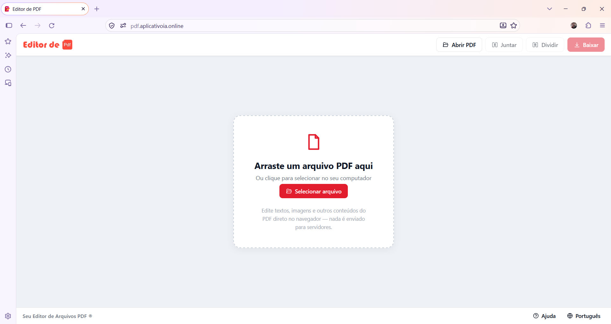
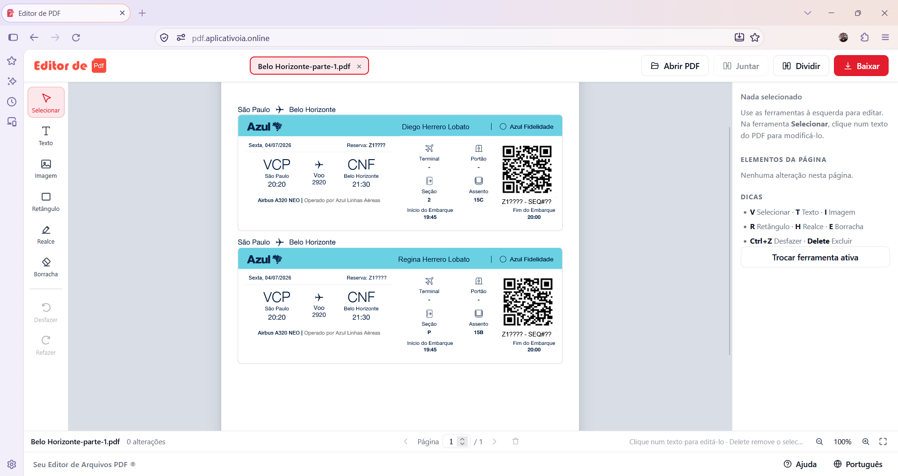

  

# Editor de Arquivos PDF

## Sobre o Editor de Arquivos PDF

O **Editor de Arquivos PDF** é uma solução voltada para a edição de arquivos no formato PDF através do navegador na web, permitindo a edição do conteúdo, junção de arquivos, divisão de arquivos, além do download em docx, odt, jpg e no formato pdf.

Todas as ações realiazadas nos arquivos acontecem no navegador, sem o envio de informações para o servidor.

## Tecnlogias Utilizadas

- NPM
- React (>=19.3.0)
- TypeScript (>=5.9.3)
- Vite (>=8.3.4)
- Eslint (>=10.12.0)

## Site com o Editor de Arquivos PDF

Site para acessar o **Editor de Arquivos PDF** para testar [https://pdf.aplicativoia.online/](https://pdf.aplicativoia.online/)

## Perguntas Frequentes (FAQ)

### Quem pode utilizar esse software?

Qualquer pessoa pode utilizar, basta possuir uma estação de trabalho com o um servidor com NPM, React, TypeScript, Vite e Eslint.

### Quem pode contribuir?

Qualquer desenvolvedor pode contribuir, sendo muito bem-vindo! Caso queira contribuir, veja nosso [Código de Conduta | Contributor Covenant Code of Conduct](CODE_OF_CONDUCT.md).

## Autor

[Diego Mendes Rodrigues](https://www.linkedin.com/in/diegomendesrodrigues/)

## Licença

A licença do **Editor de Arquivos PDF** de TI é a [GNU General Public License (GNU GPL)](LICENSE.md).

## Telas do Editor de Arquivos PDF

Tela Inicial

Edição de Um Arquivo no Formato PDF

